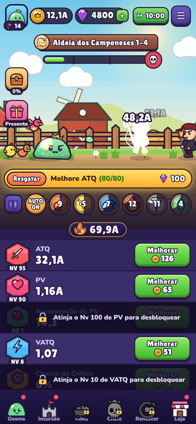
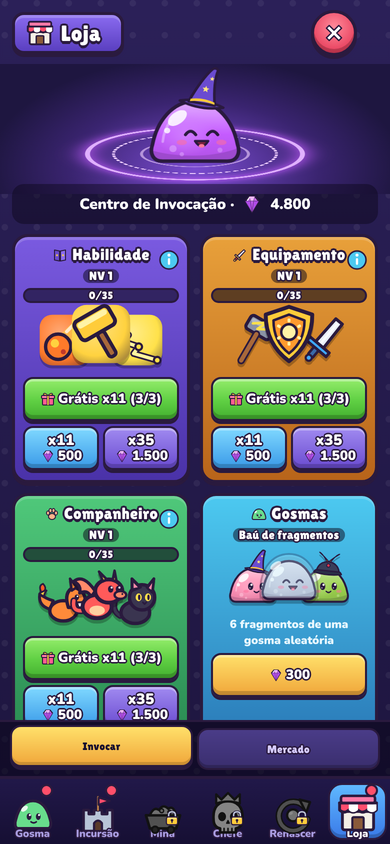
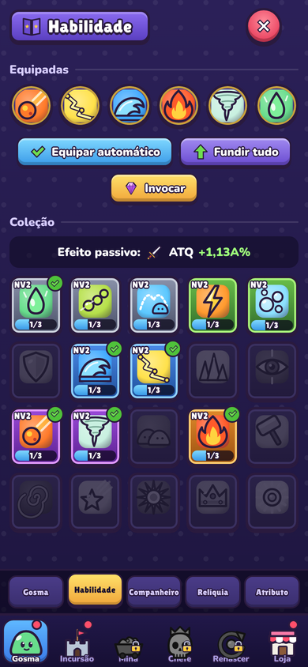

# Reino Gelatina

RPG idle de piratas para navegador e celular, inspirado em One Piece. Você cria seu capitão chibi e navega pelas 10 sagas (100 fases): do convés do seu barco você enfrenta os inimigos que vêm andando pela ilha. Seu capitão sobe de nível, treina Força, Resistência e outros atributos, desperta o Haki, ganha barcos melhores e recruta o bando, cada um com sua ULT.

Feito com HTML, CSS e JavaScript puro (módulos ES), sem bibliotecas e sem etapa de build. Toda a arte é vetorial (SVG) desenhada em código, a música e os efeitos sonoros são sintetizados com Web Audio, e o jogo funciona offline e pode ser instalado como app (PWA).

| Batalha | Invocação | Habilidades |
|---|---|---|
|  |  |  |

## Publicar no GitHub Pages

1. Crie um repositório novo no GitHub (por exemplo `reino-gelatina`).
2. Envie todos os arquivos desta pasta para a raiz do repositório (pelo site: **Add file › Upload files**, arrastando o conteúdo da pasta; ou com `git push`).
3. No repositório, abra **Settings › Pages**. Em **Build and deployment**, escolha **Deploy from a branch**, branch `main`, pasta `/ (root)` e salve.
4. Em cerca de um minuto o jogo estará em `https://SEU-USUARIO.github.io/reino-gelatina/`.

No celular, abra o endereço e use **Adicionar à tela inicial** para instalar como app.

## Rodar no computador

Os módulos JavaScript precisam de um servidor (abrir o `index.html` direto pelo arquivo não funciona). Na pasta do projeto:

```bash
npx serve .            # ou: npm start
# alternativa sem Node:
python3 -m http.server 8080
```

Depois abra `http://localhost:8080`.

## Como funciona

- **Personagem**: na primeira vez você monta seu pirata (pele, cabelo, chapéu, roupa, arma, barba e expressão). Dá para mudar depois em Pirata › Editar visual.
- **Batalha**: o barco fica no mar, à esquerda, e os inimigos vêm andando pela ilha, à direita. Ondas de inimigos e um chefe por fase, que precisa cair em 30 segundos. Só o capitão tem vida: se ele cair (ou o chefe escapar), a fase se repete sem chefe até você tocar em **Desafiar chefe**, no topo da tela.
- **XP e treino**: derrotar inimigos dá XP. Cada nível aumenta ATQ e PV e dá pontos de treino para Força, Resistência, Agilidade, Precisão e Vitalidade. O Haki desperta no nível 15 (Observação: esquiva), 30 (Armamento: dano) e 50 (Rei: atordoa e fere todos).
- **Barcos**: começa no Bote; Going Merry, Galeão da Marinha, Thousand Sunny, Moby Dick, Red Force e Oro Jackson chegam ao longo da jornada. Cada barco dá bônus que crescem com o nível e tem uma habilidade especial automática.
- **Bando**: Luffy, Zoro, Nami, Sanji, Chopper, Robin, Franky e Brook lutam do convés e soltam sua ULT sozinhos de tempos em tempos.
- **Atributos**: ATQ, PV, Recuperação, VATQ, Crítico, Dano Crítico, Ataque Duplo e Triplo, Dano em Chefes, liberados em cadeia. Segure **Melhorar** para comprar vários níveis.
- **Missões**: guiam o jogo, dão gemas e liberam conteúdo novo (Habilidade na missão 8, Equipamento na 16, Companheiro na 25, Incursão na 30, Mina na 36, Rei Toupeira na 42).
- **Invocação**: habilidades, equipamentos e companheiros em 8 raridades, com nível de invocação que melhora as chances. Cópias repetidas fundem e sobem o nível; tudo que você possui dá bônus passivo.
- **20 habilidades** com efeitos próprios, **64 equipamentos** em 4 espaços e **8 companheiros** do bando.
- **Incursão**: destrua 5 construções da vila em 45 s para ganhar pó e baús de relíquias (28 relíquias).
- **Mina**: cave blocos com picaretas e encontre ouro, gemas, bombas e 24 tesouros.
- **Rei Toupeira**: chefe que não cai; quanto mais dano em 30 s, melhor a recompensa.
- **Renascer** (fase 50): volta ao início em troca de Essência para talentos permanentes.
- **Offline**: ganhos enquanto você está fora, baú de descanso, presente diário e turbo x2.
- **Save**: automático no navegador. Em **Menu › Salvar e exportar** você copia ou baixa um código para levar o progresso a outro aparelho.

## Estrutura

```
index.html            página do jogo
manifest.webmanifest  dados do app instalável
sw.js                 service worker (funciona offline)
css/                  estilos (base, interface, telas)
js/main.js            inicialização e laço principal
js/core/              estado e save, sons e música, utilitários
js/data/              números do jogo: fórmulas, habilidades, itens, regiões, missões
js/game/              regras: batalha, invocação, modos, mina, renascer
js/render/            desenho da batalha e dos efeitos
js/art/               toda a arte em SVG gerada por código
js/ui/                interface e telas
assets/               fontes e ícones do app
tools/sim.mjs         simulador de progressão (npm run sim)
```

Para ajustar a dificuldade, edite `js/data/balance.js` e rode `npm run sim` para ver em que fase um jogador chega após 10 min, 1 h, 8 h etc.

Ao publicar uma versão nova, mude `VERSION` em `sw.js` para os jogadores receberem a atualização.

## Créditos

Código, arte, música e efeitos sonoros originais. Fontes Lilita One e Nunito sob a SIL Open Font License (veja `assets/fonts`). Inspirado no gênero de RPGs idle para celular; nenhum asset, nome ou texto de outro jogo foi usado.

Licença do código: MIT.
